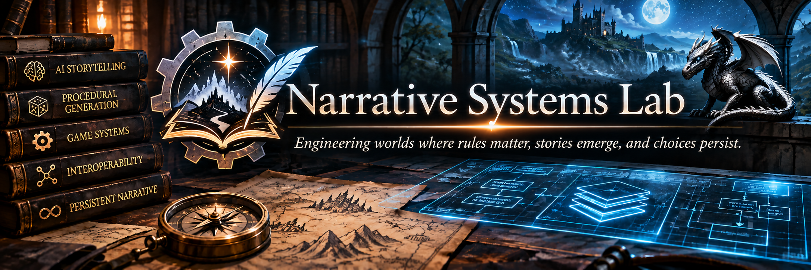

  

# 🧠 Narrative Systems Lab

### Engineering worlds where rules matter, stories emerge, and choices persist.

**Research · Procedural Generation · AI Storytelling · JavaScript Architecture**

---

> **What if an AI storyteller could improvise freely without inventing the rules?**
>
> What if independent game systems could communicate without being rewritten for one another? And what if the consequences of one adventure could follow a player into the next?

**Narrative Systems Lab** is an independent research and development project exploring the intersection of deterministic game mechanics, procedural generation, and AI-driven interactive storytelling.

The goal is to develop practical architectures that combine the creative flexibility of generative AI with the consistency, persistence, and mechanical reliability of traditional game engines.

Much of this research grows out of experimentation with **AI Dungeon** and JavaScript-based scripting systems, but the underlying ideas are intended to apply more broadly to AI-assisted games, interactive fiction, and simulated narrative worlds.

## ⚙️ The Core Philosophy

**Let code decide what is true. Let procedural systems decide what is possible. Let AI decide how to tell the story. Let the player decide what to do.**

Traditional game engines offer consistency and control, but often struggle to accommodate unexpected player actions.

Generative AI offers extraordinary flexibility, but can struggle with persistent state, numerical rules, continuity, and reliable consequences.

This research explores how to combine their strengths.

### The Narrative Architecture

```text
                  ┌─────────────────────┐
                  │    PLAYER INPUT     │
                  │  Choices & Actions  │
                  └──────────┬──────────┘
                             │
                             ▼
                  ┌─────────────────────┐
                  │ MECHANICAL AUTHORITY│
                  │    JavaScript       │
                  │ Rules, State, Rolls │
                  └──────────┬──────────┘
                             │
                             ▼
                  ┌─────────────────────┐
                  │ PROCEDURAL SYSTEMS  │
                  │ Events, Encounters, │
                  │  World Simulation   │
                  └──────────┬──────────┘
                             │
                             ▼
                  ┌─────────────────────┐
                  │    AI STORYTELLER   │
                  │ Dialogue, Narrative │
                  │   Interpretation    │
                  └──────────┬──────────┘
                             │
                             ▼
                  ┌─────────────────────┐
                  │  EMERGENT NARRATIVE │
                  │  A Reactive World   │
                  └─────────────────────┘
```

The storyteller is not the authoritative source of game rules. Instead, it transforms mechanically grounded information into coherent, engaging fiction.

The player retains agency throughout.

## 🔬 Research Projects

### 01 — Mechanically Governed Generative Storytelling

**The foundational architecture.**

Explores a layered approach to interactive storytelling in which deterministic rules, procedural simulation, and generative narration have distinct responsibilities.

Key research questions include:

- How can AI narration remain creative without contradicting game mechanics?
- How should player intent be distinguished from confirmed outcomes?
- How can persistent world state survive limited context windows?
- How can procedural systems generate meaningful events without scripting every possible story?

**Status:** Foundational research and ongoing experimentation.

**Paper:** [Mechanically Governed Generative Storytelling](papers/mechanically-governed-storytelling.md)

### 02 — ScriptBridge

**A common language for independent game systems.**

ScriptBridge proposes a lightweight, versioned interoperability protocol for JavaScript-based simulation modules.

Rather than hard-coding integrations between specific scripts, systems advertise capabilities and communicate through standardized queries, commands, and events.

For example, a magical ritual evaluated by one system could trigger a psychological event handled by another, without either system taking ownership of the other's mechanics.

**Research priorities:** Capability discovery, standardized message contracts, single mechanical authority, compatibility, graceful failure, and event deduplication.

**Status:** Proposed architecture; reference implementation pending.

**Paper:** [ScriptBridge](papers/scriptbridge.md)

### 03 — LegacyBridge

**Your story shouldn't end when the adventure does.**

LegacyBridge proposes a portable narrative continuity system that transfers significant decisions and outcomes between independent adventures.

Players could export a compact, versioned sequel code from one scenario and import it into another.

The receiving scenario would reconstruct important historical facts and use procedural generation to establish an appropriate opening.

A player who escaped captivity, betrayed an organization, or rescued a loved one would begin the sequel in a world that remembers those events.

**Research priorities:** Continuity schemas, deterministic serialization, import validation, reliable event tracking, branching scenario initialization, and multi-adventure history.

**Status:** Proposed architecture; initial application planned for a connected SCP-inspired adventure series.

**Paper:** [LegacyBridge](papers/legacybridge.md)

## 🧪 Experimental Foundations

The research is informed by several AI Dungeon scripting projects:

| Project | Research focus |
|---|---|
| **Surge Protector** | Supernatural abilities, capability enforcement, and AI compliance with defined powers |
| **MindRift** | Persistent psychological state, stress, sanity, and narrative consequences |
| **Empire of Echoes** | Procedural exploration, encounters, combat, and persistent world simulation |
| **Subterranean** | Spatial exploration, navigation, and interpretation of natural-language actions |

These projects serve as experimental environments for identifying common engineering problems and testing reusable solutions.

They are distinct from the research proposals documented here.

## 🧩 Research Themes

**Mechanical Authority** — Establishing reliable ownership of rules, outcomes, and persistent state.

**Procedural Narrative Middleware** — Translating verified mechanics into structured guidance for generative storytellers.

**Natural-Language Action Interpretation** — Recognizing meaningful player actions while avoiding false positives and unintended consequences.

**Modular Interoperability** — Enabling independent simulation systems to communicate through stable interfaces.

**Persistent Narrative Continuity** — Preserving consequential history across adventures, scenarios, and campaigns.

**Reliability Engineering** — Testing state transitions, handling ambiguous narration, preventing duplicate events, and surviving context limitations.

**Player Agency** — Preserving meaningful choices without allowing automated systems to dictate the player's intentions or decisions.

## 📂 Repository Structure

```text
narrative-systems-lab/
│
├── README.md
├── LICENSE.md
│
├── papers/
│   ├── mechanically-governed-storytelling.md
│   ├── scriptbridge.md
│   └── legacybridge.md
│
├── research/
│   └── ...
│
├── reference-architectures/
│   └── ...
│
└── prototypes/
    └── ...
```

This is the intended structure. Some directories and documents may be added as research progresses.

## 🚧 Research Status

This repository contains a mixture of architectural proposals, conceptual research, engineering observations, and potentially experimental implementations.

**A documented concept is not necessarily a working feature.**

Where applicable, individual papers and prototypes will identify their development status, assumptions, limitations, and validation results.

The goal is to move promising ideas through a progression of:

**Concept → Architecture → Prototype → Testing → Reusable Implementation**

Research findings and designs may evolve as practical experiments reveal new constraints.

## 🤝 Use, Attribution & Licensing

The written research and documentation in this repository are intended to be shared for learning, discussion, and noncommercial adaptation.

Unless otherwise noted, original written materials are licensed under **Creative Commons Attribution-NonCommercial 4.0 International (CC BY-NC 4.0)**.

You may share and adapt the licensed material for noncommercial purposes, provided you give appropriate attribution and comply with the license terms.

Commercial reuse of the licensed material requires separate permission.

Software implementations, if published, may use separate licenses.

See [LICENSE.md](LICENSE.md) for details.

## 🌌 The Bigger Picture

The long-term vision is a collection of small, understandable, independently useful systems capable of supporting richer simulated worlds.

A world where:

- Characters possess consistent abilities and limitations.
- Events produce persistent, mechanically meaningful consequences.
- Independent systems cooperate without becoming tightly coupled.
- AI storytellers improvise within a coherent simulated reality.
- Players can solve problems in ways the scenario author never anticipated.
- The consequences of one adventure can shape the next.

Not a rigidly scripted story.

Not an AI inventing everything as it goes.

**A simulated world with rules, memory, and room for genuine surprise.**

---

*Build the rules. Simulate the world. Let the story emerge.*
